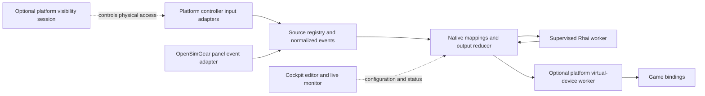

# Third party devices and controller mapping implementation plan

Status: M0 research in progress; controller mapping is not delivered. Date: 14 October 2026.

See the [M0 contract candidate](controller-mapping-contracts.md) and [qualification record](verification/2026-10-14-controller-mapping-m0.md) for executed checks and remaining gates.

Add a native input router to Cockpit so users can discover third-party controllers, combine their controls with OpenSimGear inputs, and apply mappings and custom logic on Windows, Linux and macOS. Optional platform backends create virtual devices and control physical-device visibility. Windows uses vJoy/HidHide; Linux uses native input interfaces; macOS uses a qualified Apple HID helper. Physical controllers remain visible by default. Both features require explicit activation and the platform's dependencies, permissions and setup.

Delivery covers Windows 10/11 x64, Linux and macOS through separate qualification gates. Windows is the first integration slice; Linux and macOS are included implementation milestones, with supported distributions, OS versions and architectures established in M0. Keep the engine portable and provide synthetic sources and a recording adapter everywhere. Platform support does not imply identical visibility policies, persistent OS device identities or game compatibility. This plan changes Cockpit software; existing board versions remain 0.1.0.

Joystick Gremlin is the functional reference, particularly device merging, axis transformations, modes and scripting. Cockpit will have its own profile format and scripting API rather than promise compatibility with Gremlin profiles or Python plugins. See the [Gremlin feature overview](https://whitemagic.github.io/JoystickGremlin/introduction.html).

## Scope and user workflow

The initial feature includes generic USB/HID controller discovery, live buttons/axes/hats, persistent local device assignments, multiple virtual controllers, a mapping editor, reusable profiles, built-in transformations and Rhai custom logic. Unknown controller models remain usable if they expose supported standard controls. Recognizing a vendor or model adds useful names and defaults; it does not gate generic input support.

Users can discover devices, edit mappings and inspect dry-run output without optional virtual/visibility backends. To publish virtual output, they install or enable the platform prerequisites, activate **Virtual devices**, create a controller and explicitly start an assigned mapping profile. They then bind it in their game. Mapping works independently of game discovery, DCS-BIOS and telemetry, including games Cockpit cannot launch.

To control visibility, users separately configure the platform's hiding/input-suppression backend and activate **Device hiding**. Every real device has a **Device visibility** section with Visible, Hide from all applications and Hide from a specific process choices, enabled only when the backend can enforce their stated behavior. Virtual devices work with originals visible; visibility sessions do not require virtual output. Windows uses HidHide; Linux/macOS may use explicitly enabled exclusive capture, subject to the limits below. No game-binding edits or custom cloaking driver are included. Without hiding, the setup guide explains how to remove conflicting physical bindings manually.

## Optional dependencies and activation

**Virtual devices** and **Device hiding** are independent optional features, both disabled by default on every platform. Neither is required to install, start or use Cockpit's existing gateway, game or simulator features. Do not silently install helpers/drivers, change permissions or HidHide configuration, acquire slots, seize/grab physical devices or hide devices on discovery, profile import, ordinary startup or dependency installation. vJoy and HidHide are Windows backend dependencies, not cross-platform requirements.

| User enables | Required installed dependency | Available behavior |
| --- | --- | --- |
| Neither | None | Device discovery, live inputs, profile editing and synthetic/recording previews; no game-visible virtual output or Cockpit hiding. |
| vJoy only | Qualified vJoy driver and matching runtime/configuration tools | Real virtual controllers and mapping; originals remain visible. |
| HidHide only | Qualified HidHide driver and required configuration/API support | Visibility controls in each real device, with global/process policy validation; no virtual replacement unless another tool provides one. |
| Both | Both qualified dependency sets | Map physical inputs to vJoy and optionally hide selected originals while Cockpit retains input access. |

The table above describes Windows installations. Linux readiness depends on kernel interfaces, device permissions and any optional launcher/helper; macOS readiness depends on the qualified signed helper, OS/API support and granted permissions. The same four feature combinations apply wherever their requested operations are supported.

Add separate **Virtual devices** and **Device hiding** settings with backend states: not installed, unavailable kernel/API, permission denied, unsupported, restart required, setup incomplete, ready and active. Missing prerequisites disable only the corresponding actions and provide platform-specific install/setup links and **Check again**. The user installs required dependencies or completes system setup before activation; Cockpit does not install them automatically at startup. Linux may already supply the kernel interface and need only permission setup. Installation may require elevation, a reboot or a new login; presence alone never enables a feature.

**Virtual devices** opens a dedicated workspace with **Create virtual device**, a layout editor and created-device cards. **Device hiding** enables the visibility section on each real device; it does not replace that section with a single global hide switch. With prerequisites absent or features disabled, show setup/enablement guidance without mutation. Query backend capabilities for each visibility mode and layout; unsupported options show their limitation and cannot Apply. Input suppression is labelled explicitly when the OS device remains enumerable.

Persist integration preferences separately from profile intent. Start/game preflight checks user enablement, readiness and exact backend capabilities. A required unavailable operation blocks that run; it never substitutes a preview or broad suppression for requested process-specific hiding. Other features/profiles continue to work. Disabling a feature stops dependent sessions and cleans up ownership: leave vJoy configuration intact, remove only Cockpit-owned HidHide changes, release Linux/macOS grabs/seizures and close owned virtual devices according to their backend lifetime.

Vendor firmware updates, onboard calibration writes, wheelbase force-feedback forwarding, XInput gamepad emulation and keyboard/mouse injection are separate follow-up features. Initial macros emit virtual-controller actions. Vendor LEDs, displays, settings and haptics belong to optional vendor adapters after the generic input and mapping release.

## Architecture and existing integration points

The Rhai worker exchanges bounded logic requests and output intents; its arrow back to the router does not permit virtual outputs to become physical sources. No physical event needs to pass through the Svelte interface. The panel adapter arrives after the first host-HID path.

| Existing code | Planned change |
| --- | --- |
| [Native app entry](../src-tauri/src/lib.rs) and [browser service](../src-tauri/src/bin/osg-gateway-service.rs) | Compose the same controller service beside `GatewayManager`; add bounded configuration/status IPC and orderly shutdown. |
| [Gateway manager](../src-tauri/src/gateways.rs) | Preserve gateway routing and workers; expose a narrow adapter for later panel-event sources. |
| [Device workspace](../src/App.svelte), [device types](../src/lib/devices.ts) and [gateway workspace](../src/lib/gateway-workspace.ts) | Compose gateway modules, external controllers and virtual outputs using tagged origin and capabilities. External devices appear directly below the computer in Topology. |
| [Simulator profile model](../src-tauri/src/integration_profile.rs) | Keep its current gateway/module assignments compatible; introduce a separate mapping document and source-role assignments. |
| [Game model](../src/lib/games.ts) and [game coordinator](../src-tauri/src/games.rs) | Later capture a mapping configuration in game profiles and include activation/restoration in their journal. |
| [Panel validation](../src-tauri/src/panel_events.rs) and [DCS runtime](../src-tauri/src/dcs_profile_runtime.rs) | Reuse event validation and baseline principles without importing the DCS input-eligibility restriction into virtual routing. |

Proposed modules include `controllers/registry.rs`, platform input adapters (`windows_input.rs`, `linux_input.rs`, `macos_input.rs`), `controllers/dependencies.rs`, visibility adapters (`hidhide.rs`, `linux_visibility.rs`, `macos_visibility.rs`), `mapping/{profile,engine,runtime,script}.rs` and virtual adapters (`virtual_controller/{vjoy,uinput,macos_hid}.rs`). Add output and logic-worker binaries under `src-tauri/src/bin/`. Define shared input, virtual-output and visibility interfaces with capability queries and ownership/cleanup methods. Keep the pure engine free of Tauri, OS handles and driver calls. Load optional adapters lazily; availability checks remain read-only.

### Source identity and capabilities

Persist a Cockpit source ID and match it to OS device/container identity, VID/PID, serial when exposed, collection/interface identity and a capability fingerprint. Paths and enumeration indexes are observations, not permanent identities. Prefer serial-backed matching across USB ports; ambiguous identical devices without serials require explicit reassignment. Never select a replacement just because its display name matches.

Represent buttons, axes and hats using stable backend control IDs: HID usage/collection/report/field information where available, or evdev event type/code plus device identity on Linux. Retain native range, signedness and neutral/null information. Normalize axes into documented bipolar or unipolar values while preserving native values for diagnostics. Manufacturer/model labels and semantic roles such as pedals, throttle, joystick, wheelbase or panel remain editable local metadata. An accessory connected through a base may only appear as part of that base unless the vendor exposes its identity separately.

Use tagged source references: `host-controller` with platform-specific local identity, `osg-panel-events` and `synthetic`. Portable targets reference logical virtual devices; local bindings select `vjoy`, `uinput`, `macos-hid` or `recording`. Exclude Cockpit virtual devices from source selection on every platform. Correlate OpenSimGear routes where identity is provable and prevent duplicate host/panel input routes.

Each source connection has a generation. Events carry source/control IDs, generation, sequence, monotonic capture time, value and reason. Report changes apply atomically. Preserve button edges and ordered encoder increments; only axes may coalesce under a documented policy. No report means inactivity, not necessarily disconnection: a stationary controller that only reports changes must retain its valid state.

### Mapping documents and output ownership

Create a versioned portable document containing logical source roles, logical virtual targets, rules, modes, script source/parameters, output arbitration, per-axis fallback values and declared optional-feature requirements. Visibility intent records a source role, mode (`visible`, `hide-all`, `hide-from-process`) and logical application reference where required. Device instance paths, resolved application/capture executable paths, integration enablement and vJoy slot assignments remain local settings. Import previews validation errors and never executes scripts, starts mapping, provisions slots, hides devices or changes device publication.

Start with explicit bounds: 64 KiB per mapping document, 16 source roles, eight virtual targets and 256 mapping nodes. A script may occupy at most 16 KiB within the total document limit. Validate these choices during the qualification spike and report any limit changes before releasing the schema. Do not inherit the simulator integration format's 16-input limit. Keep existing gateway request limits unchanged; the new API must account explicitly for its correlation envelope and bounded status pages.

Allow one active mapping profile initially, with several virtual targets. A live run owns its selected backend devices and has a generation token; a preview uses recording targets without optional output dependencies. Preflight validates requested features, source assignments, actual layouts and scripts before output or hiding. Acquire/create required outputs transactionally; if a target fails, release partial acquisitions and leave the previous run intact. A failed replacement restores the old configuration through a fresh baseline rather than replaying gestures. Validate portable layouts against each backend; never truncate controls silently.

Buttons use per-producer assertions combined with OR: one mapping's release cannot release another mapping's held button. Axes and hats have one writer by default; multiple writers need an explicit merge function or priority. Every writer, timer and macro belongs to a mapping node and run generation. Old generations cannot write after profile replacement.

Built-in rules and scripts feed the same reducer, which builds complete virtual reports. Preserve transitions between reports; avoid collapsing a press/release pair into an unchanged final snapshot. Generated encoder and macro pulses have configurable minimum press/release durations, initially 30 ms, because games may sample inputs more slowly than Cockpit produces reports. Validate that default in representative games.

On activation, acquire a current baseline before arming rules. Initially held momentary buttons require release before a new press; explicit level mappings can synchronize maintained switches and valid axes. On source loss, clear that source's contributions and dependent timers. On stop, cancel all pending actions, publish fallback reports and release ownership. Axis fallbacks are per control: a pedal's rest need not equal a centered stick.

## vJoy creation and feeding

Qualify the BRUNNER [v2.2.2.0 release](https://github.com/BrunnerInnovation/vJoy/releases/tag/v2.2.2.0) as the initial driver/DLL pair. Its repository describes limited maintenance, so pin the qualified artifacts and isolate the backend for future replacement. vJoy is an optional external dependency installed by the user before enabling real virtual controllers. Absent or disabled vJoy must not fail Cockpit startup or device discovery. Normal input routing runs without elevation; driver setup and slot provisioning use an explicit Windows elevation flow. Include applicable notices when distributing SDK/runtime files; see the [vJoy repository and license](https://github.com/BrunnerInnovation/vJoy).

**Provisioning is distinct from feeding.** `AcquireVJD` acquires an already configured slot. Implement the vJoy feature as **Create virtual device** in the virtual-device workspace, with selectable buttons, axes and hats, persistent created-device cards and mapping targets. Back creation with a dedicated provisioning helper, rather than treating acquisition of an existing slot as creation. Evaluate the qualified `vJoyConfig` tool in M0, but do not assume an unmodified wrapper preserves existing configuration: the first registry descriptor can replace implicit default slots, and the tool can change global FFB registration. Snapshot the complete configuration, preserve all existing published slots/layouts/FFB metadata, and re-enumerate to verify the outcome. If the stock tool fails that gate, implement a narrow helper using the qualified descriptor format while preserving existing defaults and registration. Tool exit status alone does not establish success. Layout changes can refresh the driver and disrupt other slots; refuse them while a controller is owned by another feeder and stop Cockpit mapping before provisioning. Cancellation or failure restores the captured configuration and verifies it before offering another attempt.

Use a starter layout with eight conventional axes, 32 buttons and one continuous POV, plus configurable layouts within the selected driver's advertised limits. Read actual capabilities instead of assuming all slots have the same shape. Cockpit names such as “Flight controls” are local aliases initially; the feeder SDK does not provide independent game-visible product names. Slot identity and layout remain fixed when switching mapping profiles.

The native wrapper checks `vJoyEnabled`, `DriverMatch`, slot existence/status, owner PID and actual axes/button/POV capabilities. Load a qualified DLL from an explicit trusted installation or packaged path, verify architecture/version, and use the exact C ABI and report layout for that release. `DriverMatch` alone is insufficient for artifact qualification. Report missing driver, mismatched DLL, missing controls, missing slots and ownership by another feeder as distinct errors.

The dedicated feeder owns slots with `AcquireVJD`, writes complete reports with `UpdateVJD` and releases with `RelinquishVJD`. Write an explicit fallback report immediately after acquisition; acquisition can expose retained state. Do not use `ResetVJD` as the definition of neutral because it restores configurable driver defaults, which may include pressed buttons. Keep FFB disabled for this initial input path.

Give reports a renewable run lease. A feeder that loses the mapping heartbeat publishes fallback output and stops accepting old generations. The application supervisor detects feeder exit, reacquires Cockpit's previously recorded slots when FREE and writes fallback reports before offering restart. Never take over a BUSY slot or use reset-all as recovery.

Stock vJoy does not guarantee neutral positions when every Cockpit process terminates: its file cleanup releases ownership without necessarily resetting the report. Test parent crash, worker crash, feeder kill and total termination separately. Provide a documented independent vJoy reinitialization/recovery procedure. Do not claim universal crash cleanup or add a persistent system guardian implicitly; a stronger guarantee requires a separate design decision.

## Optional HidHide device visibility

This section describes the Windows visibility adapter. Linux/macOS use the separate backends and limits below.

Use the installed [HidHide driver](https://docs.nefarius.at/projects/HidHide/) and its qualified API/configuration tools. Select a supported signed release in M0 and verify the available APIs against its binaries. Hide physical controller instances, not individual buttons or axes. Every real-device detail page exposes a **Device visibility** section; virtual-device cards have creation/layout/mapping controls instead.

| Per-device selection | Intended behavior |
| --- | --- |
| Visible | Cockpit adds no hiding rule for this device; show any externally managed hiding separately. |
| Hide from all applications | Hide this device from ordinary applications while retaining access for Cockpit's capture executable and showing existing HidHide allowlist exceptions. |
| Hide from a specific process | Select a running application or browse its executable; hide this device from that application while other applications retain access. |

Persist an executable path, not a transient PID, for the process selection. HidHide matches applications by executable path, so the rule applies to all instances at that path, including later starts; it is not an individual-PID filter. Show the effective policy, selected application, setup/readiness and **Apply visibility**/**Restore visibility** actions in the device section. Saving a selection does not activate it. A device-level action can start a standalone visibility session without vJoy or a mapping profile.

**Backend limitation and acceptance gate:** HidHide has one global application list and inverse-mode flag for the entire hidden-device set. Normal mode hides devices from applications outside that list; inverse mode hides them from listed applications. This can express a common hide-all policy or a common selected-application policy, but not arbitrary independent device/process combinations. For example, hiding device A from all applications while hiding device B only from one game cannot generally be represented by the same HidHide configuration. Implement a policy validator that evaluates all active device selections and existing external settings before making changes. Allow only exactly representable combinations; report conflicting devices/processes without silently broadening hiding or changing another device's policy. A separate backend with per-device application rules is required to deliver unrestricted independent selections, and must be scoped/qualified separately before that capability is claimed. See the [HidHide policy and inverse-mode documentation](https://docs.nefarius.at/projects/HidHide/CLI-Usage/).

During explicit setup, inspect global cloaking/application-list mode and prove access for the exact capture executable, including a browser-development service if used. In normal mode it needs an appropriate allowlist exception; in inverse mode it must remain outside the blocked application list. Do not register script workers, feeders or arbitrary games unnecessarily. Expose diagnostics for missing capture access, disabled cloaking or relocated executables. Apply a compatible global mode/list change only as part of an explicitly reviewed visibility operation, with journaled deltas and conflict-aware restoration; preserve external settings and refuse operations that alter unrelated device policies. vJoy targets must remain outside Cockpit's hide selection.

Prefer process-owned session blacklist entries when the qualified installed release supports them. The source API describes automatic removal when the owning process exits, but qualify that behavior with the selected signed driver. Tie ownership to a supervised session process whose lifetime follows the visibility/mapping session; a mapping/feeder failure ends its hiding session. If the chosen released driver supports only persistent entries, implement a separately qualified journaled adapter: record pre-existing state, exact additions, expected post-state and completed mutations before changing anything. Undo only Cockpit's additions when ownership can still be established; external changes produce a recovery conflict rather than a wholesale list restore. Persistent mode requires documented recovery after process termination and must not claim automatic unhide on crash. See the [developer API](https://github.com/nefarius/HidHide/blob/master/DEVELOPER.md) and [configuration CLI](https://docs.nefarius.at/projects/HidHide/CLI-Usage/).

For a combined session, first validate dependencies, acquire/publish fallback vJoy output and prove Cockpit can read the selected sources. Then apply hiding to the explicitly selected physical instances and verify capture still works before arming mappings or launching a game. Failed hiding rolls back the attempted hiding/output session. Device reconnect or stack rebuild requires fresh source identity/generation validation; never broaden a hide selection by matching only vendor/product IDs. Existing applications may retain access until their device handles/stack are refreshed, so offer qualified reconnect/restart guidance and verify visibility from a non-allowlisted test process instead of claiming immediate interception.

For HidHide-only sessions, **Apply visibility**/**Restore visibility** in the real-device section provides independent explicit Start/Stop and shows that no vJoy replacement is active. Do not require vJoy or a mapping profile merely to manage visibility. A standalone hiding session must not accidentally combine with a game-owned session for the same physical instance; all sessions participate in the shared global-policy compatibility check.

Stop pauses forwarding, neutralizes any owned virtual output, removes Cockpit-owned hiding entries and then releases virtual ownership. Restore prior visibility rather than assuming devices hidden by another tool will become visible. Keep **Stop hiding** and dependency recovery available during a game session. Do not change unrelated hidden devices, existing allowlist entries or another application's configuration. Journal any setup changes Cockpit performs explicitly; ordinary runtime cleanup must not reset all HidHide settings or disable another tool's cloaking.

## Linux and macOS backends and limitations

| Capability | Windows | Linux | macOS |
| --- | --- | --- | --- |
| Physical inputs | Raw Input/HID, qualified DirectInput fallback | evdev/libevdev and udev identity/hotplug | IOHIDManager/device callbacks and qualified OS permissions |
| Create virtual devices | Optional installed vJoy | Optional uinput backend with kernel/device permissions | Optional signed virtual HID helper with required Apple entitlement and permissions |
| Broad physical input suppression | HidHide filtering with application-list exceptions | Explicit EVIOCGRAB for qualified input paths; enumeration/raw HID may remain | Explicit HID seizure for qualified devices/APIs; enumeration may remain |
| Restrict a selected application | HidHide common global process policy, with conflicts rejected | Optional controlled-launch sandbox; not arbitrary already-running applications | Unsupported initially; no general per-application filtering backend is promised |

### Linux input and virtual devices

Capture evdev events outside the UI through a libevdev or equivalent Rust adapter. Use udev metadata/serial/interface identity for hotplug and reconnect, map ABS/KEY/HAT capabilities into the shared model, and handle `SYN_DROPPED` by reacquiring state and a fresh baseline. Do not assume an evdev node covers vendor-specific controls exposed only through hidraw.

Create configurable virtual joysticks through `/dev/uinput`, using kernel capability setup and coherent `SYN_REPORT` batches. Persist Cockpit device templates and local identity fields; keep the output owner alive while a created device is meant to remain present. Unlike installed vJoy slots, these devices are normally tied to an open creator handle: shutdown/crash can remove them. Recreate only under an explicitly enabled session, and qualify game binding retention across recreation rather than promising stable `/dev/input/eventN` paths. See [Linux uinput documentation](https://kernel.org/doc/html/latest/input/uinput.html).

Readiness checks verify the kernel interface, permissions for selected physical devices and access to `/dev/uinput`. Provide user-directed kernel/module and narrowly scoped udev/ACL setup, with login/reload guidance where required. Do not run the entire application as root or make all input/HID nodes globally writable. Treat distribution, desktop-session and package-sandbox differences as qualification inputs. Missing permissions block only the affected optional operation.

### Linux visibility and controlled launch

An explicitly requested broad-suppression session can use `EVIOCGRAB` on selected evdev handles. Releasing/closing the handles ends that grab; reconnect requires reacquisition under the existing identity policy. This suppresses events to other input clients, not necessarily device enumeration or access through hidraw/USB routes. Show **Block original input** as the effective behavior until tests prove the stronger Hide policy for the relevant application input paths. Do not claim system-wide HidHide parity from an evdev grab alone. See [libevdev grab semantics](https://docs.rs/evdev/latest/evdev/struct.Device.html#method.grab).

For process-specific visibility, implement a separately enabled controlled-launch adapter using a qualified sandbox/mount-namespace helper. Exclude the selected physical device's relevant evdev, joystick and hidraw nodes from the launched game while exposing approved virtual devices. Preserve access for unrelated host applications and handle hotplug without exposing newly assigned physical paths. This is a proposed backend built on [Linux mount-namespace isolation](https://man7.org/linux/man-pages/man7/mount_namespaces.7.html), not a blanket guarantee against every input broker or raw-USB route.

The mode applies only to applications launched through that isolated environment and their intended children. Do not retrofit a selected running PID or modify global device permissions to simulate per-process filtering. Steam/Proton launch chains, inherited handles, brokered input, raw USB, container packages and privileged processes need explicit qualification. Disable this mode when Cockpit cannot establish the launch boundary or supported access paths. Linux game launch integration is a new optional launcher path; the current Windows DCS/Rally launcher does not automatically provide it.

### macOS input and virtual devices

Capture real controllers through IOHIDManager/device callbacks and normalize their HID descriptors with the same identity/baseline rules. Qualify required input access on supported OS releases and on Apple silicon/Intel targets that the release supports. Discovery and reading must work independently of the virtual helper.

Use a separately installed, signed/notarized helper with Apple's required virtual-HID entitlement to create generic joystick descriptors and submit reports. Qualify `HIDVirtualDevice` on supported CoreHID releases and an `IOHIDUserDevice` path only where its deployment/API requirements are met. The helper requires an authorized signing/provisioning path; an entitlement string in an ad-hoc build is not evidence of deployment readiness. Establish minimum OS versions and the required system authorization in M0, and test actual joystick/game recognition. See [Apple virtual HID](https://developer.apple.com/documentation/corehid/hidvirtualdevice) and [the virtual-device entitlement](https://developer.apple.com/documentation/bundleresources/entitlements/com.apple.developer.hid.virtual.device).

Users install the qualified helper and grant required permissions before enabling virtual devices. Do not require vJoy/HidHide, disable OS protections or silently install a system extension. Persist templates independently of live helper-owned devices; qualify helper failure, device disappearance/recreation and game binding retention. Keep the capability unavailable if signing, entitlements, OS support or permissions are missing.

### macOS visibility

Evaluate `kIOHIDOptionsTypeSeizeDevice` for optional broad input suppression while Cockpit reads and republishes through virtual devices when requested. Apple documents exclusive communication, but qualify actual suppression with the selected device, OS and game input APIs before enabling that mode. It does not establish disappearance from enumeration or per-process filtering. See [Apple HID seizure semantics](https://developer.apple.com/documentation/iokit/1556660-anonymous/kiohidoptionstypeseizedevice).

Keep **Hide from a specific process** disabled with an unsupported-platform explanation on macOS initially. An exclusive device capture is not a substitute for selectively denying one application while leaving others unchanged. Broad suppression remains experimental/unavailable for unqualified devices; close owned handles on Stop/crash and test restoration. No custom system-wide filter or kernel extension is part of this plan.

## Custom logic

Use **Rhai** for the initial language because it integrates with Rust and provides explicit resource controls. Build the engine from `Engine::new_raw`, add only selected math/collection functions and the Cockpit API, and omit filesystem module resolution, dynamic imports, shell/network access, OS handles and direct device writes. Rhai's [raw-engine configuration](https://rhai.rs/book/engine/raw.html), [operation limits](https://rhai.rs/book/safety/max-operations.html) and [progress cancellation](https://rhai.rs/book/safety/progress.html) support this design.

Compile once before activation and cache the AST. Support `on_start`, `on_event`, `on_timer` and optional `on_stop`. Callbacks receive immutable input snapshots, named roles, event data, configured parameters and explicit prior state. They return a transaction of replacement state, output intents and timer requests. Commit only a complete validated result. Cleanup never depends on `on_stop` succeeding.

Scripts declare the source roles they read and the controls they may write. Initially, losing any declared source clears that script's entire state, output contributions and timers; reconnection requires a fresh baseline. This conservative dependency rule also covers a script combining several devices. Timers use monotonic deadlines and namespaced IDs; scripts never sleep. Runtime state resets on stop/replacement and source-generation change. Durable parameters belong in the saved profile. Simulator context, if added later, must expose freshness explicitly; basic virtual routing must not wait for telemetry.

Run evaluation in a supervised helper process outside capture and feeder threads. Serialize each script's callbacks, enforce bounded queues and discard replies from obsolete runs. On script error, timeout or worker loss, remove affected script contributions and timers, show the diagnostic, and continue unaffected built-in mappings. Restart requires explicit rearming from a new baseline. Do not automatically retry a callback that could duplicate a gesture.

Initial budgets to benchmark are 100,000 operations per callback, call depth 16, 16 KiB aggregate serialized state per script, 64 timers per script/256 per run, 128 output intents per transaction, and a 5 ms evaluation deadline. Enforce string/array/map sizes and rate-limit logs. Operation counts are not milliseconds or a total memory quota. Combine Rhai limits with supervision and qualified platform process/resource controls; test the actual limits rather than calling language restrictions a complete OS sandbox.

The editor provides syntax diagnostics, parameters, examples and dry-run execution against captured or synthetic input. A recorded trace contains the profile/script hashes, capability snapshots, source generations, accepted event order, timer scheduling and any coalescing decisions. Replay uses an injected clock and produces the same reports and state transitions without vJoy. Wall-clock time and unseeded randomness are unavailable to logic.

## Milestones and acceptance gates

Each milestone should be a reviewable change or a small series of changes. M1 and M2 can proceed independently after M0; M1P adds Linux/macOS capture. Windows M3/M3H, Linux M3L and macOS M3M use shared contracts and can be delivered independently once their source/dependency prerequisites exist. M3V qualifies Linux/macOS visibility separately from virtual output. UI work can overlap once IPC/profile contracts are fixed. Platform-specific unavailable modes do not prevent delivery of qualified capabilities elsewhere.

### M0 Qualify dependencies and freeze contracts

Create bounded research prototypes in `.research/` for Windows capture, vJoy ABI/provisioning, HidHide visibility/session APIs and Rhai execution. Record the selected driver/runtime/tool versions, hashes, API layouts and Windows setup requirements. Test user-installed dependencies with normal Windows signing protections enabled, including detection before/after reboot. Define independent enablement/readiness states and the source, event, mapping-document, output-report and session/worker protocols, including maximum sizes and generations. Qualify normal/inverse HidHide modes, executable-path matching and the policy validator; document combinations requiring a different backend instead of promising unrestricted per-device process isolation.

Also prototype Linux evdev/uinput/grab/namespace behavior and macOS input/virtual-helper/seizure APIs. Record supported distributions/desktop sessions, macOS minimum versions, architectures, signing/entitlement feasibility, permission setup and per-backend capabilities. If Apple authorization cannot be obtained, keep macOS virtual creation explicitly unavailable while completing input/preview support; document the remaining dependency rather than declaring the full backend delivered.

**Gate:** Cockpit starts with neither dependency installed; each optional integration independently rejects activation until its supported dependency and setup are ready. A physical input can be read in the background while a game is foreground; a configured vJoy slot can receive a report; provisioning preserves existing layouts/FFB registration; HidHide hides a selected source from a non-allowlisted process while Cockpit still reads it and restores only owned changes; an infinite Rhai loop can be terminated. Record unresolved driver/platform constraints before committing to the release contract.

### M1 Discover and inspect physical controllers

Implement a dedicated Windows Raw Input message loop with background registration, device notifications and HID capability parsing. Use `HidP` APIs to interpret report IDs, usages, signed axes, null hats and multi-collection devices. Filter joystick/gamepad and relevant multi-axis controller collections; keep unrecognized usages diagnostic rather than inventing controls. See Microsoft's [Raw Input examples](https://learn.microsoft.com/en-us/windows/win32/inputdev/using-raw-input) and [HID interpretation guidance](https://learn.microsoft.com/en-us/windows-hardware/drivers/hid/interpreting-hid-reports). Add a DirectInput source adapter only if qualification identifies a concrete compatibility gap; deduplicate its devices against Raw Input.

Compose the registry with the existing workspace. Add local names/roles, physical-origin labels, live input monitoring, capability diagnostics and USB branches in Topology. Do not show gateway firmware setup controls on external devices. Read published OpenSimGear HID controllers through this path too.

**Gate:** hotplug, two identical controllers, multiple collections and port changes behave according to the identity policy. Buttons, signed/unipolar axes and hats display correctly while Cockpit is unfocused. Unknown models work generically; vJoy is excluded as a source; unplug clears availability; unchanged input does not falsely expire. Existing gateway views and lifecycle tests pass.

### M1P Add Linux and macOS controller capture

Implement the Linux evdev/udev and macOS IOHID adapters, platform identities, permission diagnostics and shared inventory/monitor UI. Keep capture independent of optional output/hiding setup.

**Gate:** on each supported platform, physical buttons/axes/hats work in the background, identical devices remain distinct, hotplug/gaps establish correct generations/baselines, virtual devices cannot feed back into sources, and no optional backend is required for discovery. Test permission denial and Linux dropped-event recovery. Record actual hardware/OS coverage rather than transferring Windows vendor qualification automatically.

### M2 Build mapping profiles and the pure runtime

Implement import/export, validation, explicit role assignments, a deterministic event/timer engine, per-producer output ownership and synthetic sources/recording sinks. Start with direct button/axis/hat mapping, several sources per target and several targets per profile. Add start/stop, baseline, generation and source-loss behavior before introducing advanced rules.

**Gate:** replay fixtures prove overlapping button ownership, axis bounds, hat neutral/diagonals, source disconnect, held-at-start behavior, malformed profiles and profile replacement. Saving/importing never starts output. Ambiguous writers and cycles are rejected. The engine runs and is tested on Linux/macOS without Windows or driver dependencies.

### M3 Create and feed real virtual controllers

Implement the vJoy capability adapter, qualified provisioning helper, feeder process, leases and supervision described above. Provide **Create**, **Inspect**, **Start**, **Stop** and **Recover** actions, plus a minimal source-assignment/direct-mapping form and profile import before the full M4 editor. Recheck actual target shape at each activation. Provisioning changes driver layouts only through explicit user actions; editing mappings does not.

**Gate:** explicitly enable installed vJoy without HidHide, create two persistent slots, route a real physical button, axis and hat, and bind them in a real game while the original remains visible. With vJoy absent/disabled, discovery and recording previews still work and real-output actions offer dependency guidance. Restart Cockpit and verify layout/slot assignment retention and game bindings. Test mismatches, slots owned by Gremlin, provisioning cancellation/failure, driver refresh and partial acquisition. Verify fallback after source loss, normal stop, stale report lease and feeder death while the supervisor survives. Record total-process termination separately.

This is the first end-to-end usable slice, but the requested feature is not complete until custom logic and final qualification pass.

### M3H Add optional HidHide sessions

Implement dependency detection/setup status and the **Device visibility** section on every real device with Visible/Hide from all/Hide from a specific process choices. Add executable selection, effective-policy diagnostics, the shared normal/inverse policy validator, capture access checks, explicit session ownership, readback and Restore/recovery. Qualify session-scoped APIs when available; otherwise deliver the journaled persistent adapter with its distinct crash behavior. Add a local visibility intent to captured game/mapping settings without requiring vJoy. Gate unrepresentable independent device/process combinations on a separately qualified backend.

**Gate:** test neither installed, vJoy only, HidHide only and both installed, including installed-but-disabled states. Missing/unsupported/restart-required dependencies block only their feature. A compatible hide-all policy preserves capture access; a compatible process policy hides the selected real device from the chosen executable while a second application still reads it. Incompatible simultaneous device policies fail before mutation. With both enabled, the selected game sees the virtual device and not the selected original while Cockpit receives input. HidHide-only device sections work without vJoy. Stop, setup failure, source reconnect, executable relocation, session-owner crash and feeder loss restore owned changes or present verified recovery status. External settings survive cleanup; imports/installations never hide devices. Selected and unselected probe applications verify normal/inverse visibility after any required handle/stack refresh.

### M3L Create Linux virtual devices

Implement optional uinput creation/layout and output ownership using the common virtual-device workspace. Supply explicit user permission/setup guidance and a recording fallback for preview only.

**Gate:** create two Linux virtual controllers, map real inputs and bind them in a native game and a qualified Steam/Proton case where available. Verify descriptor/control limits, coherent reports, missing kernel/permission states, Stop/crash device removal and explicit recreation. Persist templates and measure binding retention; absence of setup never breaks ordinary Cockpit startup.

### M3M Create macOS virtual devices

Implement and package the optional qualified Apple HID helper and IPC, generic joystick descriptors, readiness/authorization checks, owned-device cleanup and explicit recreation.

**Gate:** on the chosen supported macOS versions/architectures, a signed authorized helper creates two game-visible devices, routes real controls and survives tested parent/helper failure paths. Verify actual game bindings, helper absence, entitlement/permission denial and upgrade/recreation behavior. An unsigned dry run is not a passing live-device gate; expose unavailable status until production signing and permissions are qualified.

### M3V Qualify Linux and macOS visibility modes

Add platform capability-aware controls to each real device. Qualify Linux grab-based suppression and optional controlled-launch process isolation; qualify macOS broad seizure only for supported devices/APIs. Keep macOS process-specific hiding unavailable.

**Gate:** selected/unselected probe applications verify the exact enforced scope, including enumeration versus event delivery and alternative HID paths. Linux isolated launch denies selected physical nodes while exposing virtual devices and leaving unrelated host clients unchanged; already-running/unsupported launch paths are rejected. Linux/macOS Stop, helper/capture failure and reconnect release owned suppression and establish fresh baselines. Missing dependencies/permissions and unsupported modes cannot mutate state or fall back to broader blocking. Test visibility-only and virtual-output-only operation separately on each platform.

### M4 Add the mapping editor and built in transformations

Add a **Mappings** workspace with source-role assignment, target layout, input learning, rule chains, modes and a live raw/transformed/output inspector. Provide direct mapping and one-to-one presets. Add dead zones, inversion, scaling, piecewise curves, axis merging/splitting, button-to-axis, axis thresholds with hysteresis, modifiers, chords, tap/hold/double-tap, toggles and ordered virtual-input macros/pulse/repeat.

Learn mode records the intended physical control without running output. Clearly show deferred tap/double-tap behavior, arbitration and timing. Save edits as drafts; replace a running profile through the normal neutralization/baseline transition. Keep UI status updates throttled and separate from the input path.

**Gate:** fixture traces cover curve endpoints, threshold noise, overlapping holds, modifier release, layer change during a held button, overlapping pulses and stop during a macro. Native output continues while the UI is busy. The inspector explains which node holds each virtual control. UI checks and existing transport tests pass.

### M5 Add custom logic and trace replay

Implement the Rhai helper/API, compile diagnostics, budget enforcement, transactional replies, editor examples and recording/replay. Examples should include a shift layer, short/long press, conditional output from two physical controls and an axis threshold with state/hysteresis. Test generated pulse timing through the same reducer as built-in rules.

**Gate:** a user-written script modifies real virtual output. Syntax errors prevent activation; infinite loops, recursion, state growth, timer/log/output floods and helper termination produce bounded failure and release affected output. Unplugging either source from a two-device script clears its state, outputs and timers. Failed callbacks produce no partial transactions. Capture/UI/feeder remain responsive, and the same trace generates identical output on repeated runs. Old timer/worker replies cannot reactivate a stopped profile.

### M6 Integrate OpenSimGear panel events and game profiles

Add an explicit panel-event source over the current ordered, nonconsuming event contract for richer encoders, switches and inputs with gateway HID disabled. Preserve gateway/module/boot/stream validation and per-consumer cursors. Do not use neutralized gateway HID snapshots as the source. [The event contract](https://github.com/opensimgear/protocol/blob/main/serial/panel-input-events.md) excludes hats; disabled-HID hat support needs a later protocol/firmware extension and must not be advertised here.

Add captured mapping/visibility intent and independent virtual-device/hiding requirements through an explicit game-profile schema migration; schema-1 profiles and recovery journals remain readable. Requirements are platform-neutral and local readiness checks select a compatible backend. No optional feature becomes mandatory for profiles that do not request it. Journal prior settings/assignments/running flags, desired snapshots and ownership mutations before side effects; restore only session-owned expected state. Windows DCS/Rally coordination remains a Windows capability. Manual mapping works everywhere; Linux isolated launch is its own explicitly supported launcher and does not imply native DCS/Rally support on Linux/macOS.

Preflight all requested optional operations before changing hardware. Apply hardware configuration and await re-enumeration, resolve inputs, prepare the selected virtual outputs, apply qualified visibility intent and verify capture, then arm mapping/integrations and any supported launch boundary. Neutralize output and release visibility before restoring hardware; resume prior mappings through fresh baselines. Controller/mapping/visibility IPC participates in game-session guards. Status, discovery and emergency Stop/Stop hiding remain available. Recovery never replays macros, silently reactivates scripts or reapplies hiding just because a journal exists.

Keep manual mapping available for any game. Preserve the existing DCS-BIOS rule requiring disabled direct/gateway HID for its direct-command input routes; virtual mapping has independent source eligibility. Diagnose known profile overlap that could send the same gesture as both virtual input and a direct simulator command without attempting to inspect arbitrary game bindings.

**Gate:** panel event consumers coexist, event gaps/reboots establish fresh baselines and duplicate source routes cannot activate accidentally. DCS/Rally profiles activate captured mappings and only explicitly requested optional integrations; missing dependencies fail preflight before side effects. Failed launch rolls back mapping/hiding; later editor changes do not alter the captured run; interrupted sessions offer explicit recovery. Old profiles/journals still recover, mutation guards block conflicting edits, and externally changed mapping/visibility state is preserved with a conflict diagnostic. Existing integration output leases, setup sessions and multiple-gateway isolation retain their tests.

### M7 Qualify and document the complete feature

Finish Windows helper packaging/vJoy/HidHide setup, Linux kernel/permission/optional-launcher setup and macOS signed-helper/permission setup. Document unavailable modes and device lifetimes in platform guides. Verify optional dependencies cannot break app loading. Add native compilation/tests on supported Windows/Linux/macOS CI targets and use platform machines for real device/game checks; mocked tests and ad-hoc macOS signatures do not establish deployment readiness.

**Gate:** verify the matrix below, record coverage and latency results, and update the README/repository description to match delivered capabilities before any push. Keep the feature labelled experimental until physical input, vJoy enumeration and real-game binding checks pass.

## Verification and coverage

| Area | Required evidence |
| --- | --- |
| Portable engine and profile format | Deterministic traces, validation bounds, source generations, arbitration, state machines, pulse timing, import/export and migration. |
| Windows input parsing | Authored HID/report fixtures for IDs, signed ranges, hats, arrays and composite devices, plus real capture/foreground-game tests. |
| Linux/macOS inputs | Native evdev/IOHID capture, identities, dropped-event/baseline behavior, permission denial, hotplug and real device/game checks per supported OS. |
| vJoy | Mock SDK error/ownership paths plus actual slot provisioning, complete reports, reconnection, driver refresh, process failure and restart. |
| Linux virtual devices | uinput permissions, configured capabilities, coherent events, creator lifetime, recreation and native/qualified Proton bindings. |
| macOS virtual devices | Signed entitled helper, OS/API availability, required permissions, live joystick recognition, failure cleanup and recreation. |
| Optional dependencies | Neither installed, each installed alone, both installed, installed-but-disabled, unsupported versions, reboot/setup requirements, user enable/disable and dependency removal during a session. |
| HidHide | Each real-device visibility section, executable-path selection, selected/unselected probe applications, normal/inverse modes, incompatible device-policy rejection, capture access, external settings preservation, session/persistent API qualification, rollback/conflicts and process failure recovery. |
| Linux/macOS visibility | Suppression versus enumeration, alternative HID paths, Linux isolated-launch scope/permissions/children, macOS qualified seizure and disabled process mode, ownership cleanup and reconnect. |
| Custom logic | Syntax/runtime/budget errors, transactional outputs, worker process failure, stale replies, deterministic timer replay and resource ceilings. |
| Existing Cockpit behavior | Gateway lifecycle, DCS-BIOS, simulator profiles, output leases, multiple gateways and game rollback regression suites. |
| Vendor hardware | At least one available representative VIRPIL/VKB flight controller and MOZA/SIMAGIC racing device; record exact models, firmware and connection topology. Unsupported/unavailable models remain unqualified rather than receiving blanket brand support claims. |
| Games | Real DCS and one racing game with vJoy-only originals visible and combined vJoy/HidHide originals hidden; verify captured opt-in requirements, rollback, reconnect/restart and supported controls. |

Keep new Rust engine/profile/script/supervision code and frontend helpers above 70% coverage, with CI thresholds of at least 71% for measurable lines/branches/functions. Report each platform adapter separately and instrument its native tests rather than excluding difficult branches. Coverage does not replace driver/helper/device checks. Extend `pnpm check`, transport/native tests and coverage workflow with platform mapping commands; keep scratch builds, helper scripts and acceptance artifacts in `.research/`.

Benchmark capture-to-successful-vJoy-submit latency with several sources and high-rate axis traffic. Initial target for built-in mappings on the qualification machine is p95 below 5 ms and p99 below 10 ms, excluding configured gesture/pulse delays and game sampling. Measure script latency, queue depth/coalescing, missed source transitions and feeder faults separately. These are qualification targets, not current performance claims. Keep button ordering correct under overload; a queue gap faults/rebaselines the affected source instead of silently losing a release.

## Later integrations

After the mapping release, vendor adapters can advertise additional actions such as VKB/VIRPIL lighting or SDK-exposed MOZA settings. Qualify each model/firmware combination and keep generic reading available when an adapter is absent. SIMAGIC displays/haptics need a verified device protocol or supported bridge. Reuse Cockpit's typed action concepts, but do not assume third-party hardware implements OpenSimGear endpoint leases or readback.

Direct third-party input to DCS-BIOS can later use a versioned tagged source assignment and the same normalized events. Keep simulator-specific command semantics separate from virtual joystick rules. Telemetry-aware custom logic, Gremlin import, alternative scripting languages, keyboard/mouse macros and FFB forwarding need separate scopes. Linux/macOS input/output and qualified visibility backends are included above; unrestricted macOS process-specific filtering and general filtering of already-running Linux processes remain outside this implementation.

## Research references

The vJoy source used for planning is pinned at `5c3a6528ce5e192ee425dc024407238f02c87e83` in the workspace research checkout `.research/vjoy-third-party-analysis`. Relevant upstream definitions are the [SDK interface](https://github.com/BrunnerInnovation/vJoy/blob/5c3a6528ce5e192ee425dc024407238f02c87e83/SDK/inc/vjoyinterface.h), [configuration tool](https://github.com/BrunnerInnovation/vJoy/blob/5c3a6528ce5e192ee425dc024407238f02c87e83/apps/vJoyConf/vJoyConfig/vJoyConfig.cpp), [report structures](https://github.com/BrunnerInnovation/vJoy/blob/5c3a6528ce5e192ee425dc024407238f02c87e83/inc/public.h) and [driver ownership cleanup](https://github.com/BrunnerInnovation/vJoy/blob/5c3a6528ce5e192ee425dc024407238f02c87e83/driver/sys/rawpdo.c). Source qualification does not replace testing the selected signed binaries.

The HidHide source used for planning is pinned at `2b950fd9393e1644b4199f6eb4999e1720f0c6e9` in `.research/hidhide-controller-analysis`. The [developer guide at that revision](https://github.com/nefarius/HidHide/blob/2b950fd9393e1644b4199f6eb4999e1720f0c6e9/DEVELOPER.md) describes persistent and process-owned session APIs; M0 must establish which are present in the chosen signed release before relying on their lifecycle guarantees.
