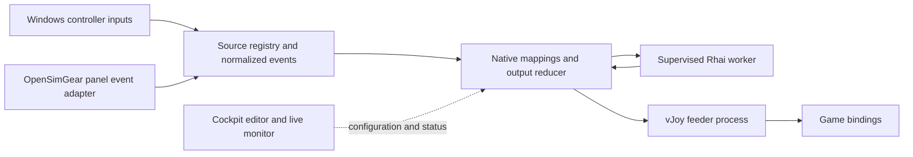

# Third party devices and controller mapping implementation plan

Status: planned. Date: 14 October 2026.

Add a native input router to Cockpit so users can discover third-party controllers, combine their controls with OpenSimGear inputs, apply mappings and custom logic, and publish the result through vJoy virtual joysticks. Games bind to those virtual controls. Physical controllers remain visible throughout.

The first production target is Windows 10/11 x64. Keep the mapping engine portable and provide synthetic sources and a recording output adapter on every development platform. Native Linux/macOS controller and virtual-device backends are later work. This plan changes Cockpit software; existing board versions remain 0.1.0.

Joystick Gremlin is the functional reference, particularly device merging, axis transformations, modes and scripting. Cockpit will have its own profile format and scripting API rather than promise compatibility with Gremlin profiles or Python plugins. See the [Gremlin feature overview](https://whitemagic.github.io/JoystickGremlin/introduction.html).

## Scope and user workflow

The initial feature includes generic USB/HID controller discovery, live buttons/axes/hats, persistent local device assignments, multiple virtual controllers, a mapping editor, reusable profiles, built-in transformations and Rhai custom logic. Unknown controller models remain usable if they expose supported standard controls. Recognizing a vendor or model adds useful names and defaults; it does not gate generic input support.

Users create a virtual controller, assign physical devices to profile roles, map controls, inspect the resulting output and explicitly start the profile. They then bind the virtual controller in their game. Mapping works independently of game discovery, DCS-BIOS and telemetry, including games Cockpit cannot launch.

Original-device hiding is out of scope. Do not add HidHide, a device-cloaking driver, exclusive acquisition, automatic removal of physical controllers, or game-binding edits. The setup guide must explain that users remove conflicting physical bindings in the game themselves.

Vendor firmware updates, onboard calibration writes, wheelbase force-feedback forwarding, XInput gamepad emulation and keyboard/mouse injection are separate follow-up features. Initial macros emit virtual-controller actions. Vendor LEDs, displays, settings and haptics belong to optional vendor adapters after the generic input and mapping release.

## Architecture and existing integration points

The Rhai worker exchanges bounded logic requests and output intents; its arrow back to the router does not permit virtual outputs to become physical sources. No physical event needs to pass through the Svelte interface. The panel adapter arrives after the first host-HID path.

| Existing code | Planned change |
| --- | --- |
| [Native app entry](../src-tauri/src/lib.rs) and [browser service](../src-tauri/src/bin/osg-gateway-service.rs) | Compose the same controller service beside `GatewayManager`; add bounded configuration/status IPC and orderly shutdown. |
| [Gateway manager](../src-tauri/src/gateways.rs) | Preserve gateway routing and workers; expose a narrow adapter for later panel-event sources. |
| [Device workspace](../src/App.svelte), [device types](../src/lib/devices.ts) and [gateway workspace](../src/lib/gateway-workspace.ts) | Compose gateway modules, external controllers and virtual outputs using tagged origin and capabilities. External devices appear directly below the computer in Topology. |
| [Simulator profile model](../src-tauri/src/integration_profile.rs) | Keep its current gateway/module assignments compatible; introduce a separate mapping document and source-role assignments. |
| [Game model](../src/lib/games.ts) and [game coordinator](../src-tauri/src/games.rs) | Later capture a mapping configuration in game profiles and include activation/restoration in their journal. |
| [Panel validation](../src-tauri/src/panel_events.rs) and [DCS runtime](../src-tauri/src/dcs_profile_runtime.rs) | Reuse event validation and baseline principles without importing the DCS input-eligibility restriction into virtual routing. |

Proposed native modules are `controllers/registry.rs`, `controllers/windows_input.rs`, `mapping/profile.rs`, `mapping/engine.rs`, `mapping/runtime.rs`, `mapping/script.rs` and `virtual_controller/vjoy.rs`. Add feeder and logic-worker binaries under `src-tauri/src/bin/`. Keep the pure engine free of Tauri, Windows handles and vJoy calls so tests run without drivers.

### Source identity and capabilities

Persist a Cockpit source ID and match it to OS device/container identity, VID/PID, serial when exposed, collection/interface identity and a capability fingerprint. Paths and enumeration indexes are observations, not permanent identities. Prefer serial-backed matching across USB ports; ambiguous identical devices without serials require explicit reassignment. Never select a replacement just because its display name matches.

Represent buttons, axes and hats using stable control IDs derived from HID usage, collection, report and field information. Retain native range, signedness and neutral/null information. Normalize axes into documented bipolar or unipolar values while preserving native values for diagnostics. Manufacturer/model labels and semantic roles such as pedals, throttle, joystick, wheelbase or panel remain editable local metadata. An accessory connected through a base may only appear as part of that base unless the vendor exposes its identity separately.

Use tagged source references: `host-hid`, `osg-panel-events` and `synthetic`. Virtual targets use `vjoy` or `recording`. Exclude vJoy and Cockpit virtual targets from source selection in the initial release. Correlate OpenSimGear routes where identity is provable; prevent selecting both host HID and panel events for the same logical controls when that would duplicate input.

Each source connection has a generation. Events carry source/control IDs, generation, sequence, monotonic capture time, value and reason. Report changes apply atomically. Preserve button edges and ordered encoder increments; only axes may coalesce under a documented policy. No report means inactivity, not necessarily disconnection: a stationary controller that only reports changes must retain its valid state.

### Mapping documents and output ownership

Create a versioned portable document containing logical source roles, logical virtual targets, rules, modes, script source/parameters, output arbitration and per-axis fallback values. Keep physical OS identities and vJoy slot assignments in local settings. Import previews validation errors and never executes scripts, starts mapping, provisions slots or changes device publication.

Start with explicit bounds: 64 KiB per mapping document, 16 source roles, eight virtual targets and 256 mapping nodes. A script may occupy at most 16 KiB within the total document limit. Validate these choices during the qualification spike and report any limit changes before releasing the schema. Do not inherit the simulator integration format's 16-input limit. Keep existing gateway request limits unchanged; the new API must account explicitly for its correlation envelope and bounded status pages.

Allow one active mapping profile initially, with several virtual targets. A run owns its selected vJoy slots exclusively and has a generation token. Preflight validates all source assignments, capabilities, target layouts and scripts before enabling output. If any required target cannot be acquired, release acquisitions and leave the previous running profile intact. A replacement uses a validated handoff; if it fails after the old run stops, restore the old configuration through a fresh baseline rather than replaying old gestures.

Buttons use per-producer assertions combined with OR: one mapping's release cannot release another mapping's held button. Axes and hats have one writer by default; multiple writers need an explicit merge function or priority. Every writer, timer and macro belongs to a mapping node and run generation. Old generations cannot write after profile replacement.

Built-in rules and scripts feed the same reducer, which builds complete virtual reports. Preserve transitions between reports; avoid collapsing a press/release pair into an unchanged final snapshot. Generated encoder and macro pulses have configurable minimum press/release durations, initially 30 ms, because games may sample inputs more slowly than Cockpit produces reports. Validate that default in representative games.

On activation, acquire a current baseline before arming rules. Initially held momentary buttons require release before a new press; explicit level mappings can synchronize maintained switches and valid axes. On source loss, clear that source's contributions and dependent timers. On stop, cancel all pending actions, publish fallback reports and release ownership. Axis fallbacks are per control: a pedal's rest need not equal a centered stick.

## vJoy creation and feeding

Qualify the BRUNNER [v2.2.2.0 release](https://github.com/BrunnerInnovation/vJoy/releases/tag/v2.2.2.0) as the initial driver/DLL pair. Its repository describes limited maintenance, so pin the qualified artifacts and isolate the backend for future replacement. The signed driver is an external installation dependency; normal input routing runs without elevation. Driver setup and slot provisioning use an explicit Windows elevation flow. Include applicable notices when distributing SDK/runtime files; see the [vJoy repository and license](https://github.com/BrunnerInnovation/vJoy).

**Provisioning is distinct from feeding.** `AcquireVJD` acquires an already configured slot. Implement Cockpit's **Create virtual controller** through a dedicated provisioning helper, rather than treating acquisition as creation. Evaluate the qualified `vJoyConfig` tool in M0, but do not assume an unmodified wrapper preserves existing configuration: the first registry descriptor can replace implicit default slots, and the tool can change global FFB registration. Snapshot the complete configuration, preserve all existing published slots/layouts/FFB metadata, and re-enumerate to verify the outcome. If the stock tool fails that gate, implement a narrow helper using the qualified descriptor format while preserving existing defaults and registration. Tool exit status alone does not establish success. Layout changes can refresh the driver and disrupt other slots; refuse them while a controller is owned by another feeder and stop Cockpit mapping before provisioning. Cancellation or failure restores the captured configuration and verifies it before offering another attempt.

Use a starter layout with eight conventional axes, 32 buttons and one continuous POV, plus configurable layouts within the selected driver's advertised limits. Read actual capabilities instead of assuming all slots have the same shape. Cockpit names such as “Flight controls” are local aliases initially; the feeder SDK does not provide independent game-visible product names. Slot identity and layout remain fixed when switching mapping profiles.

The native wrapper checks `vJoyEnabled`, `DriverMatch`, slot existence/status, owner PID and actual axes/button/POV capabilities. Load a qualified DLL from an explicit trusted installation or packaged path, verify architecture/version, and use the exact C ABI and report layout for that release. `DriverMatch` alone is insufficient for artifact qualification. Report missing driver, mismatched DLL, missing controls, missing slots and ownership by another feeder as distinct errors.

The dedicated feeder owns slots with `AcquireVJD`, writes complete reports with `UpdateVJD` and releases with `RelinquishVJD`. Write an explicit fallback report immediately after acquisition; acquisition can expose retained state. Do not use `ResetVJD` as the definition of neutral because it restores configurable driver defaults, which may include pressed buttons. Keep FFB disabled for this initial input path.

Give reports a renewable run lease. A feeder that loses the mapping heartbeat publishes fallback output and stops accepting old generations. The application supervisor detects feeder exit, reacquires Cockpit's previously recorded slots when FREE and writes fallback reports before offering restart. Never take over a BUSY slot or use reset-all as recovery.

Stock vJoy does not guarantee neutral positions when every Cockpit process terminates: its file cleanup releases ownership without necessarily resetting the report. Test parent crash, worker crash, feeder kill and total termination separately. Provide a documented independent vJoy reinitialization/recovery procedure. Do not claim universal crash cleanup or add a persistent system guardian implicitly; a stronger guarantee requires a separate design decision.

## Custom logic

Use **Rhai** for the initial language because it integrates with Rust and provides explicit resource controls. Build the engine from `Engine::new_raw`, add only selected math/collection functions and the Cockpit API, and omit filesystem module resolution, dynamic imports, shell/network access, OS handles and direct device writes. Rhai's [raw-engine configuration](https://rhai.rs/book/engine/raw.html), [operation limits](https://rhai.rs/book/safety/max-operations.html) and [progress cancellation](https://rhai.rs/book/safety/progress.html) support this design.

Compile once before activation and cache the AST. Support `on_start`, `on_event`, `on_timer` and optional `on_stop`. Callbacks receive immutable input snapshots, named roles, event data, configured parameters and explicit prior state. They return a transaction of replacement state, output intents and timer requests. Commit only a complete validated result. Cleanup never depends on `on_stop` succeeding.

Scripts declare the source roles they read and the controls they may write. Initially, losing any declared source clears that script's entire state, output contributions and timers; reconnection requires a fresh baseline. This conservative dependency rule also covers a script combining several devices. Timers use monotonic deadlines and namespaced IDs; scripts never sleep. Runtime state resets on stop/replacement and source-generation change. Durable parameters belong in the saved profile. Simulator context, if added later, must expose freshness explicitly; basic virtual routing must not wait for telemetry.

Run evaluation in a supervised helper process outside capture and feeder threads. Serialize each script's callbacks, enforce bounded queues and discard replies from obsolete runs. On script error, timeout or worker loss, remove affected script contributions and timers, show the diagnostic, and continue unaffected built-in mappings. Restart requires explicit rearming from a new baseline. Do not automatically retry a callback that could duplicate a gesture.

Initial budgets to benchmark are 100,000 operations per callback, call depth 16, 16 KiB aggregate serialized state per script, 64 timers per script/256 per run, 128 output intents per transaction, and a 5 ms evaluation deadline. Enforce string/array/map sizes and rate-limit logs. Operation counts are not milliseconds or a total memory quota. Combine Rhai limits with process supervision and Windows process limits for the worker; test the actual limits rather than calling language restrictions a complete OS sandbox.

The editor provides syntax diagnostics, parameters, examples and dry-run execution against captured or synthetic input. A recorded trace contains the profile/script hashes, capability snapshots, source generations, accepted event order, timer scheduling and any coalescing decisions. Replay uses an injected clock and produces the same reports and state transitions without vJoy. Wall-clock time and unseeded randomness are unavailable to logic.

## Milestones and acceptance gates

Each milestone should be a reviewable change or a small series of changes. M1 and M2 can proceed independently after M0; vJoy feeding joins them in M3. UI work can overlap native implementation once the typed IPC and profile contracts are fixed.

### M0 Qualify dependencies and freeze contracts

Create bounded research prototypes in `.research/` for Windows capture, vJoy ABI/provisioning and Rhai execution. Record the selected driver/DLL versions, hashes, SDK layout and Windows setup requirements. Test installation with normal Windows signing protections enabled. Define the source, event, mapping-document, output-report and worker protocols, including maximum sizes and generations.

**Gate:** a physical input can be read in the background while a game is foreground; a configured vJoy slot can receive a report; the selected provisioning route creates a second slot while preserving every existing layout and FFB registration, including a default-only installation; an infinite Rhai loop can be terminated. Record unresolved driver/platform constraints before committing to the release contract.

### M1 Discover and inspect physical controllers

Implement a dedicated Windows Raw Input message loop with background registration, device notifications and HID capability parsing. Use `HidP` APIs to interpret report IDs, usages, signed axes, null hats and multi-collection devices. Filter joystick/gamepad and relevant multi-axis controller collections; keep unrecognized usages diagnostic rather than inventing controls. See Microsoft's [Raw Input examples](https://learn.microsoft.com/en-us/windows/win32/inputdev/using-raw-input) and [HID interpretation guidance](https://learn.microsoft.com/en-us/windows-hardware/drivers/hid/interpreting-hid-reports). Add a DirectInput source adapter only if qualification identifies a concrete compatibility gap; deduplicate its devices against Raw Input.

Compose the registry with the existing workspace. Add local names/roles, physical-origin labels, live input monitoring, capability diagnostics and USB branches in Topology. Do not show gateway firmware setup controls on external devices. Read published OpenSimGear HID controllers through this path too.

**Gate:** hotplug, two identical controllers, multiple collections and port changes behave according to the identity policy. Buttons, signed/unipolar axes and hats display correctly while Cockpit is unfocused. Unknown models work generically; vJoy is excluded as a source; unplug clears availability; unchanged input does not falsely expire. Existing gateway views and lifecycle tests pass.

### M2 Build mapping profiles and the pure runtime

Implement import/export, validation, explicit role assignments, a deterministic event/timer engine, per-producer output ownership and synthetic sources/recording sinks. Start with direct button/axis/hat mapping, several sources per target and several targets per profile. Add start/stop, baseline, generation and source-loss behavior before introducing advanced rules.

**Gate:** replay fixtures prove overlapping button ownership, axis bounds, hat neutral/diagonals, source disconnect, held-at-start behavior, malformed profiles and profile replacement. Saving/importing never starts output. Ambiguous writers and cycles are rejected. The engine runs and is tested on Linux/macOS without Windows or driver dependencies.

### M3 Create and feed real virtual controllers

Implement the vJoy capability adapter, qualified provisioning helper, feeder process, leases and supervision described above. Provide **Create**, **Inspect**, **Start**, **Stop** and **Recover** actions, plus a minimal source-assignment/direct-mapping form and profile import before the full M4 editor. Recheck actual target shape at each activation. Provisioning changes driver layouts only through explicit user actions; editing mappings does not.

**Gate:** create two persistent slots, route a real physical button, axis and hat, and bind them in a real game while the original controller remains visible. Restart Cockpit and verify layout/slot assignment retention and game bindings. Test missing driver/DLL, mismatches, slots owned by Gremlin, provisioning cancellation/failure, driver refresh and partial acquisition. Verify fallback after source loss, normal stop, stale report lease and feeder death while the supervisor survives. Record total-process termination separately.

This is the first end-to-end usable slice, but the requested feature is not complete until custom logic and final qualification pass.

### M4 Add the mapping editor and built in transformations

Add a **Mappings** workspace with source-role assignment, target layout, input learning, rule chains, modes and a live raw/transformed/output inspector. Provide direct mapping and one-to-one presets. Add dead zones, inversion, scaling, piecewise curves, axis merging/splitting, button-to-axis, axis thresholds with hysteresis, modifiers, chords, tap/hold/double-tap, toggles and ordered virtual-input macros/pulse/repeat.

Learn mode records the intended physical control without running output. Clearly show deferred tap/double-tap behavior, arbitration and timing. Save edits as drafts; replace a running profile through the normal neutralization/baseline transition. Keep UI status updates throttled and separate from the input path.

**Gate:** fixture traces cover curve endpoints, threshold noise, overlapping holds, modifier release, layer change during a held button, overlapping pulses and stop during a macro. Native output continues while the UI is busy. The inspector explains which node holds each virtual control. UI checks and existing transport tests pass.

### M5 Add custom logic and trace replay

Implement the Rhai helper/API, compile diagnostics, budget enforcement, transactional replies, editor examples and recording/replay. Examples should include a shift layer, short/long press, conditional output from two physical controls and an axis threshold with state/hysteresis. Test generated pulse timing through the same reducer as built-in rules.

**Gate:** a user-written script modifies real virtual output. Syntax errors prevent activation; infinite loops, recursion, state growth, timer/log/output floods and helper termination produce bounded failure and release affected output. Unplugging either source from a two-device script clears its state, outputs and timers. Failed callbacks produce no partial transactions. Capture/UI/feeder remain responsive, and the same trace generates identical output on repeated runs. Old timer/worker replies cannot reactivate a stopped profile.

### M6 Integrate OpenSimGear panel events and game profiles

Add an explicit panel-event source over the current ordered, nonconsuming event contract for richer encoders, switches and inputs with gateway HID disabled. Preserve gateway/module/boot/stream validation and per-consumer cursors. Do not use neutralized gateway HID snapshots as the source. [The event contract](https://github.com/opensimgear/protocol/blob/main/serial/panel-input-events.md) excludes hats; disabled-HID hat support needs a later protocol/firmware extension and must not be advertised here.

Add an optional captured mapping configuration to game profiles through an explicit schema migration; schema-1 profiles retain their current meaning and existing recovery journals remain readable. Before side effects, journal the prior mapping configuration, local assignments and running flag, the desired captured snapshot/hash, and attempted/completed ownership mutations. Restore only if current mapping still matches the expected session-owned state; external changes produce a recovery conflict instead of being overwritten.

Apply hardware configuration first and wait for publication/re-enumeration before resolving input assignments, then start mapping and simulator integration/launch. Neutralize and stop the session mapping before restoring hardware; restore the prior mapping through a fresh baseline after normal exit. New controller/mapping mutation IPC participates in the game-session guard so users cannot replace a captured active mapping behind the coordinator. Status, discovery and emergency Stop remain available. Recovery never replays macros or silently reactivates scripts.

Keep manual mapping available for any game. Preserve the existing DCS-BIOS rule requiring disabled direct/gateway HID for its direct-command input routes; virtual mapping has independent source eligibility. Diagnose known profile overlap that could send the same gesture as both virtual input and a direct simulator command without attempting to inspect arbitrary game bindings.

**Gate:** panel event consumers coexist, event gaps/reboots establish fresh baselines and duplicate source routes cannot activate accidentally. DCS/Rally profiles activate captured mappings; failed launch rolls back; later editor changes do not alter the captured run; interrupted sessions offer explicit recovery. Old profiles/journals still recover, mutation guards block conflicting edits, and externally changed mapping state is preserved with a conflict diagnostic. Existing integration output leases, setup sessions and multiple-gateway isolation retain their tests.

### M7 Qualify and document the complete feature

Finish Windows packaging for helper executables and the vJoy dependency setup flow, dependency notices, troubleshooting, import/export migration and user guides. Add Windows native compilation/tests to CI; use a dedicated Windows machine for signed-driver and real-game tests rather than treating mocks as hardware evidence.

**Gate:** verify the matrix below, record coverage and latency results, and update the README/repository description to match delivered capabilities before any push. Keep the feature labelled experimental until physical input, vJoy enumeration and real-game binding checks pass.

## Verification and coverage

| Area | Required evidence |
| --- | --- |
| Portable engine and profile format | Deterministic traces, validation bounds, source generations, arbitration, state machines, pulse timing, import/export and migration. |
| Windows input parsing | Authored HID/report fixtures for IDs, signed ranges, hats, arrays and composite devices, plus real capture/foreground-game tests. |
| vJoy | Mock SDK error/ownership paths plus actual slot provisioning, complete reports, reconnection, driver refresh, process failure and restart. |
| Custom logic | Syntax/runtime/budget errors, transactional outputs, worker process failure, stale replies, deterministic timer replay and resource ceilings. |
| Existing Cockpit behavior | Gateway lifecycle, DCS-BIOS, simulator profiles, output leases, multiple gateways and game rollback regression suites. |
| Vendor hardware | At least one available representative VIRPIL/VKB flight controller and MOZA/SIMAGIC racing device; record exact models, firmware and connection topology. Unsupported/unavailable models remain unqualified rather than receiving blanket brand support claims. |
| Games | Real DCS and one racing game with physical originals visible and virtual controls explicitly bound; verify reconnect/restart behavior and supported button/axis limits. |

Keep new Rust engine/profile/script/supervision code and frontend mapping helpers above 70% coverage, with CI thresholds of at least 71% for measurable lines/branches/functions. Report platform-adapter coverage separately and add Windows coverage instrumentation instead of excluding the difficult branches. Coverage does not replace real Windows driver and device checks. Extend the existing `pnpm check`, transport/native tests and coverage workflow with mapping-specific commands; keep scratch builds, helper scripts and acceptance artifacts in `.research/`.

Benchmark capture-to-successful-vJoy-submit latency with several sources and high-rate axis traffic. Initial target for built-in mappings on the qualification machine is p95 below 5 ms and p99 below 10 ms, excluding configured gesture/pulse delays and game sampling. Measure script latency, queue depth/coalescing, missed source transitions and feeder faults separately. These are qualification targets, not current performance claims. Keep button ordering correct under overload; a queue gap faults/rebaselines the affected source instead of silently losing a release.

## Later integrations

After the mapping release, vendor adapters can advertise additional actions such as VKB/VIRPIL lighting or SDK-exposed MOZA settings. Qualify each model/firmware combination and keep generic reading available when an adapter is absent. SIMAGIC displays/haptics need a verified device protocol or supported bridge. Reuse Cockpit's typed action concepts, but do not assume third-party hardware implements OpenSimGear endpoint leases or readback.

Direct third-party input to DCS-BIOS can later use a versioned tagged source assignment and the same normalized events. Keep simulator-specific command semantics separate from virtual joystick rules. Telemetry-aware custom logic, Gremlin import, alternative scripting languages, native Linux/macOS output backends, keyboard/mouse macros and FFB forwarding each need their own scope and acceptance gate.

## Research references

The vJoy source used for planning is pinned at `5c3a6528ce5e192ee425dc024407238f02c87e83` in the workspace research checkout `.research/vjoy-third-party-analysis`. Relevant upstream definitions are the [SDK interface](https://github.com/BrunnerInnovation/vJoy/blob/5c3a6528ce5e192ee425dc024407238f02c87e83/SDK/inc/vjoyinterface.h), [configuration tool](https://github.com/BrunnerInnovation/vJoy/blob/5c3a6528ce5e192ee425dc024407238f02c87e83/apps/vJoyConf/vJoyConfig/vJoyConfig.cpp), [report structures](https://github.com/BrunnerInnovation/vJoy/blob/5c3a6528ce5e192ee425dc024407238f02c87e83/inc/public.h) and [driver ownership cleanup](https://github.com/BrunnerInnovation/vJoy/blob/5c3a6528ce5e192ee425dc024407238f02c87e83/driver/sys/rawpdo.c). Source qualification does not replace testing the selected signed binaries.
